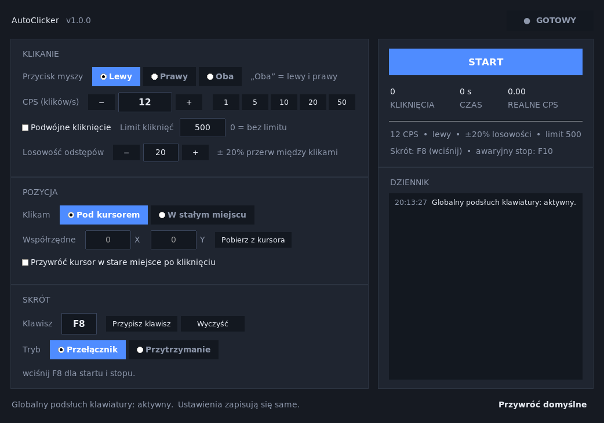

# AutoClicker

A lightweight auto-clicking application built with **Python and Tkinter**. It allows you to automate left and right mouse clicks with a configurable clicks-per-second (CPS) rate and a customizable global keyboard shortcut.

Global hotkeys work even when the application window is minimized or running in the background, including while using games or other applications.



## Features

- **Mouse button selection:** Left, right, or both mouse buttons simultaneously.
- **Configurable CPS:** Set the clicks-per-second rate using a text field, increment/decrement buttons, or predefined presets.
- **Custom global hotkey:** Assign any supported keyboard key by clicking "Assign Hotkey" and pressing your preferred key (e.g. F8, Q, or Space).
- **Two activation modes:**
  - **Toggle mode:** Press the assigned hotkey once to start clicking and again to stop.
  - **Hold mode:** Clicking continues only while the assigned hotkey is held down.
- **Click limit:** Set a maximum number of clicks (0 means unlimited).
- **Double-click mode:** Automatically perform double-clicks.
- **Randomized intervals:** Introduce configurable ±% variations between clicks.
- **Fixed click position:** Automatically move the cursor to specified coordinates before clicking.
- **Cursor restoration:** Optionally restore the cursor to its original position after clicking.
- **Emergency stop:** F10 immediately stops the clicking process.
- **Activity logging:** View application events and activity logs.
- **Click statistics:** Track total clicks, elapsed time, and actual CPS.
- **Automatic settings persistence:** Configuration is automatically saved to `%APPDATA%\AutoClicker\settings.json`.

## Requirements

- **Python 3.9+** with Tkinter.
  - Windows and macOS generally include Tkinter by default.
  - On Linux, install it using `sudo apt install python3-tk`.
- **pynput >= 1.7.6** – the only external Python dependency.

## Getting Started

Clone the repository and install the required dependencies:

```bash
pip install -r requirements.txt
```

Run the application:

```bash
python app.py
```

On Windows, you can use `pythonw app.py` instead to launch the application without opening a console window.

## Windows Installation and Packaging

The `packaging/` directory contains scripts for installing and building the application.

| Script | Description | Output |
| --- | --- | --- |
| `packaging/Instaluj.bat` | Creates a virtual environment, installs dependencies, and creates a desktop shortcut. | Desktop shortcut (no EXE build required) |
| `packaging/Build-EXE.bat` | Packages the application into a standalone executable using PyInstaller. | `dist/AutoClicker.exe` |
| `packaging/Build-Installer.bat` | Builds the executable and compiles a Windows installer using Inno Setup. | `installer/AutoClicker-Setup-1.0.0.exe` |

### Inno Setup

Building the installer requires the free [Inno Setup 6](https://jrsoftware.org/isdl.php).

If Inno Setup is not installed, the build script displays a download link and exits without affecting the project.

The installer provides:

- An entry in Windows "Add or Remove Programs".
- A desktop shortcut.
- A Start Menu shortcut.
- Installation without requiring administrator privileges.

To uninstall the application:

- Run `packaging/Odinstaluj.bat` when using the script-based installation.
- Alternatively, uninstall **AutoClicker** through Windows Settings.

## Usage

1. Select the mouse button you want to use.
2. Set your desired CPS rate (e.g. `12`).
3. Click **Assign Hotkey** and press the key you want to use.
4. Choose between Toggle and Hold mode.
5. Press your assigned hotkey or use the START/STOP button to control clicking.

Press **F10** at any time to immediately stop the clicking process.

### Configuration Options

- **Randomized Intervals:** Adjusts the delay between clicks by a configurable ± percentage. This prevents perfectly uniform clicking intervals and can produce a more natural clicking pattern.
- **Fixed Position:** Moves the cursor to predefined coordinates before each click. Use **Get from Cursor** to automatically capture the current cursor position.
- **Restore Cursor Position:** Returns the cursor to its original location after clicking. This option is available only when Fixed Position is enabled.
- **Hotkey Restrictions:** Modifier keys such as Ctrl, Alt, Shift, and Caps Lock cannot be assigned as standalone hotkeys.

## Keyboard Shortcuts

| Shortcut | Action |
| --- | --- |
| Custom hotkey | Starts/stops clicking or activates clicking while held, depending on the selected mode. |
| `F10` | Emergency stop. |
| `Esc` | Cancels the hotkey assignment dialog. |

## Project Structure

```text
app.py                  Main Tkinter application and hotkey integration
click_engine.py         Clicking engine: timing, limits, randomization, and positioning
mouse_backend.py        pynput wrapper for mouse clicks and cursor positioning
hotkeys.py              Hotkey representation and global keyboard listener
settings.py             Default values, validation, and configuration persistence
paths.py                Configuration directories and resource paths
theme.py                Application appearance and styling
assets/                 Application icon and screenshots
packaging/              PyInstaller, Inno Setup, and installation scripts
tests/                  Unit tests and end-to-end tests
```

## Running Tests

Install the testing dependency:

```bash
pip install pytest
```

Run the test suite:

```bash
python -m pytest tests -q
```

### Test Details

`tests/test_app_headless.py` attempts to launch the actual application window. It automatically skips the GUI test when no display is available (e.g. in CI environments). On Linux, a valid `DISPLAY` environment variable is required.

`tests/e2e_global_hotkey.py` performs a live end-to-end test. It launches the application, simulates pressing `F8` using `pynput`, and measures the actual number of mouse clicks generated.

Run the test directly from Python source files:

```bash
python tests/e2e_global_hotkey.py
```

Or test the packaged executable:

```bash
python tests/e2e_global_hotkey.py dist/AutoClicker.exe
```

## Troubleshooting

**The global hotkey does not work when an application is running with administrator privileges.**

Windows restricts lower-privileged processes from monitoring keyboard input in higher-privileged applications. Try running AutoClicker as an administrator.

**Clicking does not work in a game.**

Some games ignore injected mouse events or block them through anti-cheat systems. This is a limitation imposed by the operating system or the game itself, rather than necessarily an issue with AutoClicker.

**Antivirus software or Windows SmartScreen flags `AutoClicker.exe`.**

PyInstaller executables may occasionally trigger security warnings, especially when they are not digitally signed. Possible solutions include code signing, adding an appropriate antivirus exception after verifying the executable, or running the application directly from its Python source files.

**The activity log displays "Global keyboard listener: unavailable".**

This may indicate that `pynput` is missing or that the application does not have access to the Linux display server. Wayland may also restrict global keyboard shortcuts at the display-server level.

In such cases, hotkeys may work only while the AutoClicker window is focused. You can also use the built-in START/STOP button.

**Clicking becomes slower at very high CPS values.**

At rates above approximately 60 CPS, the actual clicking speed may become limited by the operating system and event-processing overhead.

Check the **REAL CPS** indicator to see the actual clicking rate achieved.

## Disclaimer

AutoClicker is intended for personal use, testing, and automation purposes.

Using automated clicking software in online games may violate their terms of service and result in account restrictions or bans. Use this application responsibly and at your own risk.